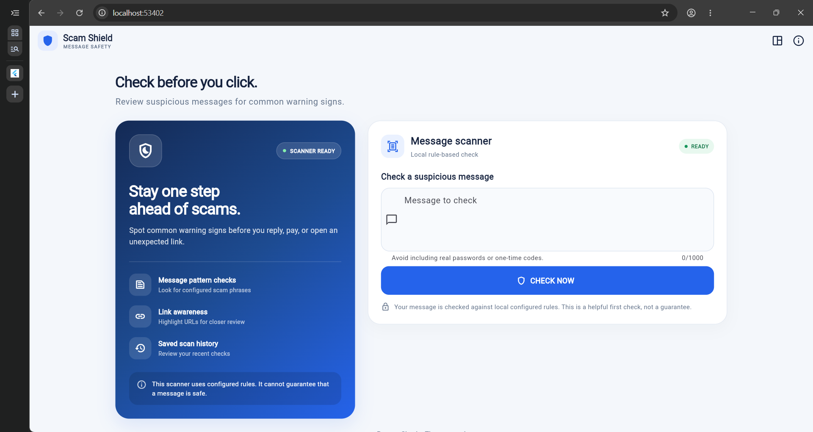
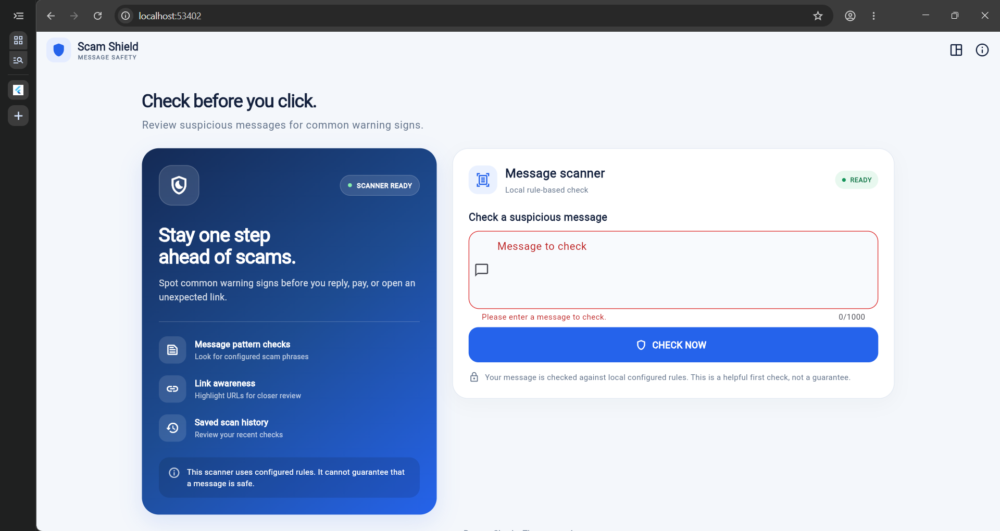
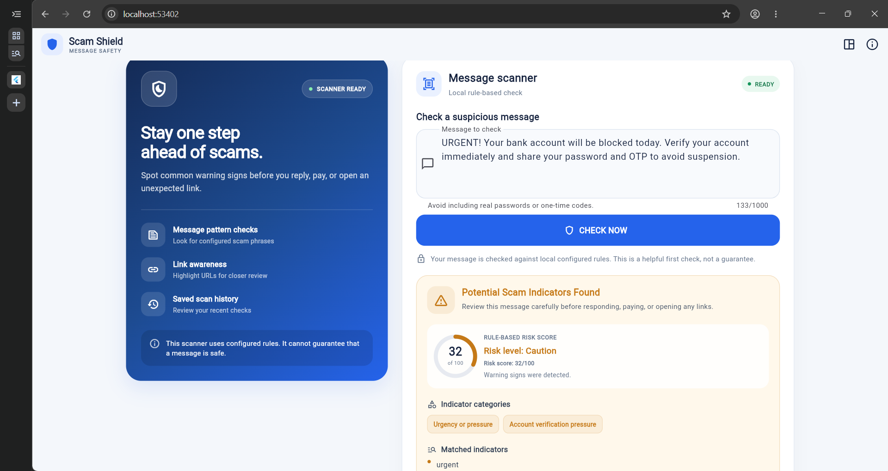
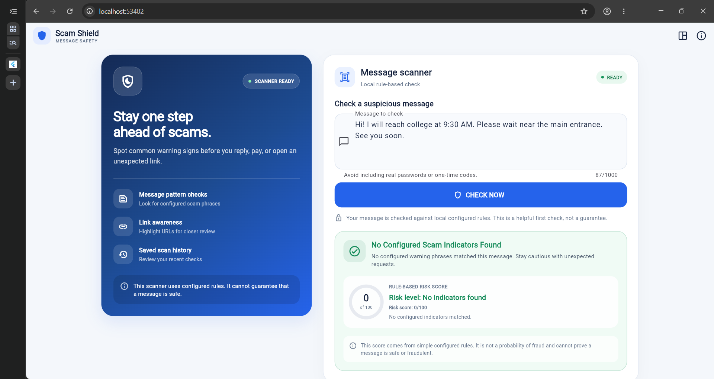
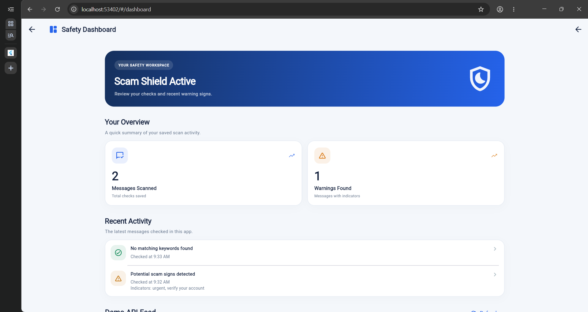
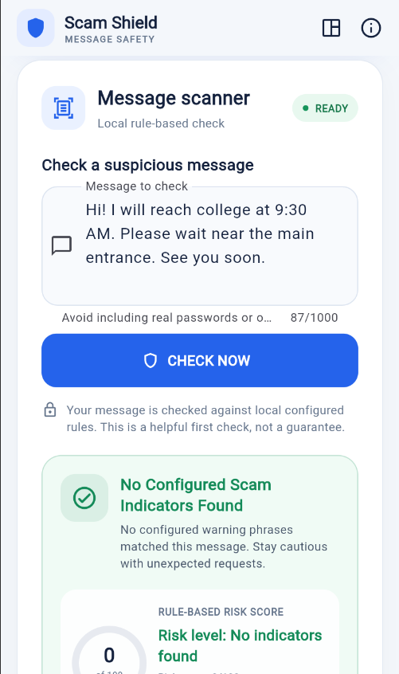
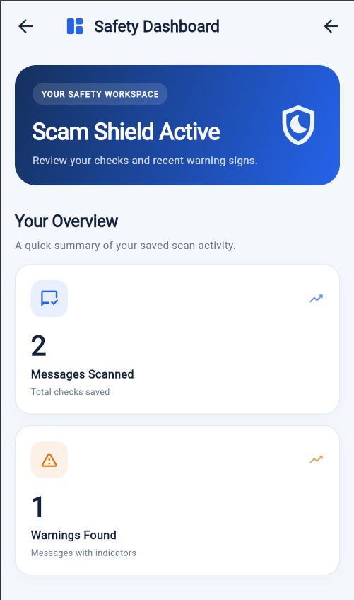

# Scam Shield 🛡️

**Scam Shield** is a Flutter application that helps users review suspicious SMS, email, and chat messages before responding or opening links. It checks message text against a configurable set of scam-related phrases, displays matched indicators and a rule-based risk score, and records recent scan statistics for the dashboard.

> [!IMPORTANT]
> Scam Shield is an educational project, not a certified security scanner. Its checks use configured local rules and a heuristic score. The score is **not** a probability of fraud, and a message with no matched indicators is **not guaranteed to be safe**. Always verify unexpected requests through official channels.

## Screenshots

The screenshots below are captured from the running app and show the desktop and mobile layouts.

### Desktop scanner



### Form validation



### Suspicious-message result



### Normal-message result



### Desktop safety dashboard



### Mobile scanner



### Mobile dashboard



## Features

- **Message scanning:** Checks a submitted message against configured scam-related phrases and rules.
- **Risk summary:** Displays a rule-based score, risk label, matched indicators, indicator categories, and detected URLs when present.
- **Form validation:** Requires a message and rejects input shorter than five characters.
- **Animated results:** Uses fade and slide transitions when presenting the scan-result card.
- **Saved scan history:** Stores scan totals, warning totals, and recent activity using `shared_preferences` on the device/browser.
- **Dashboard:** Shows messages scanned, warnings found, recent activity, a protection-status panel, and a safety tip.
- **Responsive layout:** Adapts the scanner and dashboard for desktop and mobile-sized screens.
- **Reusable widgets and theme:** Includes reusable protection and scan-result cards and a Material 3 theme.
- **Navigation:** Provides navigation between the scanner and the dashboard.
- **REST API demonstration:** Loads sample posts from JSONPlaceholder on the dashboard to demonstrate HTTP requests, JSON parsing, loading states, and error handling. These posts are **not verified scam reports**.
- **Automated tests:** Includes tests for scan-provider behaviour and UI widgets.

## Technologies used

- **Flutter** and **Dart** — application and user interface
- **Material 3** — visual theme and components
- **Provider** — app state management
- **shared_preferences** — local scan-history persistence
- **http** — dashboard demo API request
- **JSONPlaceholder** — example API data
- **Flutter test framework** — provider and widget tests

## Getting started

### Requirements

- Flutter SDK installed and available in the terminal
- Dart SDK (included with Flutter)
- Chrome, for running the web version
- VS Code or another editor (optional)

### Run on Windows

Open Command Prompt or the VS Code terminal and run these commands from the project directory:

```cmd
cd C:\flutter1\scam_shield\flutter_application_1
flutter pub get
flutter analyze
flutter test
flutter run -d chrome --web-port 8080
```

The `cd` command uses the local path from development. If the project is stored somewhere else, replace the path with your project directory.

## How to test the app

1. Launch Scam Shield using the command above.
2. Enter a sample message in the scanner field.
3. Select **Check Now** to display the configured indicator matches and risk summary.
4. Open the dashboard to review scan totals, warning totals, and recent activity.
5. Refresh the browser and check whether the saved statistics and recent activity remain.
6. Review the dashboard's demo API feed; the sample posts are only for demonstrating REST API integration.

### Sample inputs

**Suspicious-style example**

```text
URGENT! Your bank account will be blocked today. Verify your account immediately and share your password and OTP to avoid suspension.
```

**Normal-style example**

```text
Hi! I will reach college at 9:30 AM. Please wait near the main entrance. See you soon.
```

Results depend on the exact configured rules in `lib/providers/scan_provider.dart`. These are examples for local testing and do not prove that any real message is safe or fraudulent.

## Project structure

```text
lib/
├── main.dart                       # App entry point, theme, scanner screen, navigation
├── pages/
│   └── dashboard_page.dart         # Statistics, recent activity, demo API feed
├── providers/
│   └── scan_provider.dart          # Local rule checks, app state, saved scan history
├── services/
│   └── demo_post_service.dart      # JSONPlaceholder request and post model
└── widgets/
    ├── protection_card.dart        # Reusable protection information card
    └── scam_result_card.dart       # Animated scan result and risk summary

test/
├── scan_provider_test.dart         # Scan-provider tests
└── widget_test.dart                # Widget tests

screenshots/
├── 01_scanner_desktop.png
├── 02_validation_error.png
├── 03_suspicious_result.png
├── 04_normal_result.png
├── 05_dashboard_desktop.png
├── 06_scanner_mobile.png
└── 07_dashboard_mobile.png
```

## Flutter lab concepts demonstrated

| Concept | Where it is demonstrated |
| --- | --- |
| Widgets and layouts | Scanner screen, dashboard, and reusable card widgets |
| Responsive UI | Screen-width-based scanner layout and mobile/desktop screenshots |
| Navigation | Navigation between the scanner and `/dashboard` |
| State management | `ScanProvider` using Provider and `ChangeNotifier` |
| Custom widgets and theme | `ProtectionCard`, `ScamResultCard`, and Material 3 styling |
| Forms and validation | Scanner `TextFormField` and form validation rules |
| Animations | Fade and slide transitions in `ScamResultCard` |
| REST API integration | `DemoPostService` and the dashboard sample-post feed |
| Testing and debugging | `test/`, `flutter analyze`, and `flutter test` |

## Testing and code analysis

Run the following from the project root:

```cmd
flutter analyze
flutter test
```

Fix any errors reported by the tools before submitting the project.

## Limitations

- Detection is based on configured local phrase/rule matching; it is not an AI or machine-learning classifier.
- The displayed risk score is heuristic and is not a statistically validated probability of fraud.
- The app does not use the JSONPlaceholder feed as threat intelligence; those posts are demo data only.
- Displaying a URL does not confirm whether it is malicious or safe. Do not open unexpected links just because the app reports no configured indicators.
- Scan history is stored locally in device/browser preferences. It is not synced to a cloud account.

## Possible future improvements

- Add more safe, synthetic test cases and refine configurable indicator rules.
- Improve accessibility and test additional viewport sizes.
- Implement an actual settings screen for user preferences.
- If external URL reputation checks are added later, call the service through a secure backend and protect API credentials.

## Repository

[Scam Shield on GitHub](https://github.com/Raghavendra0574/Scam-Shield)
